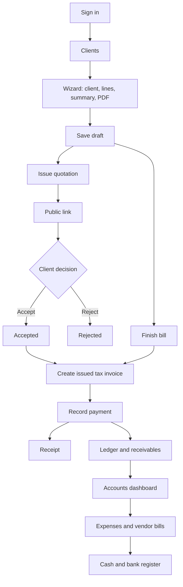

# Cravora Solutions — System Reference

This document describes how the quotation, tax invoice, and accounts application works. It is the map of screens, data, APIs, and money rules. Use it when changing a module so the rest of the flow stays intact.

The application belongs to one company, Cravora Solutions. It is not a multi-company product. A client’s company name is the customer. A vendor is someone Cravora pays. Those two parties are kept apart. A receipt for one client cannot be applied to another client’s invoice, and a vendor payment cannot be applied to another vendor’s bill.

---

## 1. What the system does

Staff sign in and then:

1. Keep a client list.
2. Build a quotation or a billing document in a four-step wizard.
3. Issue that document, email it, and let the client accept or reject it on a public link.
4. Convert an accepted quotation, or a finished bill, into one issued tax invoice.
5. Record payments against that invoice and issue receipts.
6. Track what clients still owe, including advances and partial payments.
7. Record expenses and vendor bills, pay them from cash or bank accounts, and review the books.

A **Billing** document in the wizard is still a quotation-style document. It is not a tax invoice. A **tax invoice** is a separate record created from an accepted quotation or from a finished bill. Saving or downloading the PDF does not create that invoice.

---

## 2. How to run it

| Piece | Command | Address |
| --- | --- | --- |
| Frontend | `npm run dev` in the project root | `http://localhost:5173` |
| API | `npm start` in `backend/` | `http://localhost:5001` |
| Checks | `npm run typecheck` and `npm run lint` in the project root | Frontend only |
| Finance tests | `npm test` in `backend/` | Does not write to MongoDB |

The frontend calls `http://localhost:5001`. That address is `API_BASE` in `src/utils/api.ts`.

MongoDB comes from `MONGODB_URI`. If that variable is missing, the API uses `mongodb://127.0.0.1:27017/cravora_quotations`. Email uses SMTP variables in the environment: `SMTP_HOST`, `SMTP_PORT`, `SMTP_USER`, `SMTP_PASSWORD`, and `SMTP_FROM`. The API port is `PORT`, or `5001` when unset. Secrets stay in `.env`. They are not stored in this document.

---

## 3. Stack and folders

| Layer | Technology |
| --- | --- |
| Screens | React 18, TypeScript, Vite, Tailwind, React Router |
| Wizard state | Zustand in `src/store/quotationStore.ts` |
| PDF | `html2canvas` and `jspdf`, drawn from React templates |
| API | Node.js, Express 5, CommonJS |
| Data | MongoDB through Mongoose |
| Mail | nodemailer |

```text
src/pages/            screens
src/components/       navbar, PDF templates, auth gate, GST form
src/store/            quotation wizard state
src/utils/            API client, currency, PDF, CSV
backend/models/       MongoDB collections
backend/routes/       HTTP handlers
backend/utils/        money, numbering, auth, audit
backend/services/     email only
backend/scripts/      historical payment reconcile (manual)
```

`@supabase/supabase-js` is installed on the frontend and unused. MongoDB is the database.

---

## 4. Whole system flow



The same client record can be picked in the wizard. The quotation stores a **copy** of the client details (`clientInfo`). Later edits to the client do not rewrite old quotations or invoices.

---

## 5. Sign-in and roles

### First visit and later visits

`GET /api/auth/status` says whether an account exists.

- No user yet: the login screen creates the one admin with `POST /api/auth/setup`. Password must be at least 8 characters. That user is always `admin`.
- A user already exists: `POST /api/auth/login`.

A successful sign-in returns a random session token. The browser stores it in `localStorage` as `cravora.token` and sends `Authorization: Bearer <token>` on later calls. Sessions last 14 days. `POST /api/auth/logout` deletes the session. `GET /api/auth/me` returns the email and role.

`RequireAuth` wraps every screen except `/login` and `/public/quotation/:token`. A 401 clears the token and sends the browser to `/login`.

### Roles

| Role | What they can do |
| --- | --- |
| `admin` | Everything, including accounts posts |
| `accounts` | Can post accounts, payments, and receipts |
| `viewer` | Can open accounts screens. Posts return 403 |

The setup account is `admin`. There is no screen to create more users. A role change is a database change on the user, followed by a new sign-in. Sessions that have no role stored are treated as `admin`, so existing sign-ins keep working.

Passwords are stored as a salt and an scrypt hash. The API never returns the hash.

### What is public

Only these routes skip the session:

- `GET /api/auth/status`
- `POST /api/auth/setup`
- `POST /api/auth/login`
- `/api/public/quotations/:token` and its accept and reject actions

The public page finds a document by `publicToken` only. It cannot change totals, invoice status, payment status, or internal notes.

---

## 6. Clients

**Screen:** `/clients`  
**API:** `/api/clients`  
**Collection:** `Client`

A client is the customer master: company name, contact, email, mobile, GSTIN, billing address, shipping address, website, and notes. Company name and email are required. GSTIN and mobile are checked when they are filled in.

| Action | Route |
| --- | --- |
| List and search | `GET /api/clients` |
| One client | `GET /api/clients/:id` |
| Create | `POST /api/clients` |
| Update | `PUT /api/clients/:id` |
| Delete | `DELETE /api/clients/:id` |

The wizard can select a saved client. That stores `clientId` on the quotation. The name, email, address, and GST details shown on the document are the snapshot in `clientInfo`, not a live link. Changing the client later leaves old quotations and invoices as they were issued.

---

## 7. Quotation and billing wizard

**Screens:** `/` → `/modules` → `/summary` → `/pdf-preview`  
**State:** `useQuotationStore` in the browser, plus drafts in MongoDB  
**API:** `/api/quotations`  
**Collection:** `Quotation`

The navbar item **New quotation** starts this wizard. `ProgressStepper` shows three stages: Client & project, Items & price, and Review & send. The PDF page stays one click away from review.

### Step 1 — Client & project (`/`)

Staff enter the project and the client snapshot:

- Client name and email (required before issue)
- Project name and description
- Currency: `INR` or `USD`
- Pricing: `Hourly` or `Fixed`
- GSTIN, PAN, addresses, place of supply
- Optional link to a saved client (`clientId`)

`documentType` is `Quotation` or `Billing`.

### Step 2 — Items & price (`/modules`)

Each line has an id, name, description, hours, rate, and total. The line total is `hours × rate`, rounded to two decimals. At least one named line is required before issue. Hours and rate must be zero or greater.

### Step 3 — Review & send (`/summary`)

Discount is a percent of the subtotal, from 0 to 100. GST is chosen here. Staff can save a draft, issue the document, or continue to the PDF.

### Step 4 — PDF preview (`/pdf-preview`)

`PdfDocument` is the on-screen template. `pdfGenerator.ts` turns that DOM node into a PDF with html2canvas and jsPDF. Download happens in the browser. The PDF is not stored in MongoDB. Email can attach the PDF that the browser just built.

Bank name, account, IFSC, and payment QR on the PDF come from `src/utils/paymentProfile.ts`. That profile is saved in the browser, not in MongoDB. Settings is where staff edit it.

### Drafts

`useAutoSave` periodically calls the store’s `saveDraft`. New documents start as drafts (`isDraft: true`). Saving a draft must not turn a sent, viewed, accepted, rejected, expired, or converted quotation back into a draft.

### Issue

`POST /api/quotations/:id/issue` is allowed from `draft` or `final`.

The server recalculates totals. It stores them on the quotation and freezes a copy in `issuedSnapshot`. Later edits must not change that snapshot. Reprint and the public page read the snapshot.

Issue also:

- sets status to `sent`
- sets `isDraft` to false
- creates `publicToken` if one does not exist
- writes an audit event `quotation_issued`

Calling issue again returns the same document. It does not build a second snapshot.

### Status values

`draft`, `sent`, `viewed`, `accepted`, `rejected`, `expired`, `converted`, `final`.

If an old row has no status, `isDraft: true` means draft and `isDraft: false` means `final`.

| Status | Meaning |
| --- | --- |
| `draft` | Still being edited |
| `final` | Older completed rows that were not issued through the current flow |
| `sent` | Issued. Public link exists |
| `viewed` | Client opened the public link |
| `accepted` | Client accepted on the public page |
| `rejected` | Client rejected on the public page |
| `expired` | Past the validity date where that state is set |
| `converted` | An invoice has been created from it |

Issued quotations cannot be deleted. `DELETE /api/quotations/:id` removes one draft by `quotationId` only.

### Numbers

`POST /api/quotations/next-number` allocates the next id.

| Document | Pattern |
| --- | --- |
| Quotation | `QTN-YYYY-NNN` |
| Billing | `BILL-YYYY-NNN` |

`NNN` is at least three digits. The counter lives in the `Counter` collection. Creating a quotation requires `quotationId` and rejects duplicates.

### Email

`POST /api/quotations/:id/email` sends only after issue. The browser may include `pdfBase64`. The API refuses an attachment larger than about 20 MB. The attempt is appended to `emailLog` and to the audit log. SMTP must be configured or the send fails with a clear message.

### Other quotation routes

| Action | Route |
| --- | --- |
| List | `GET /api/quotations` |
| One | `GET /api/quotations/:id` |
| Create | `POST /api/quotations` |
| Update | `PUT /api/quotations/:id` |
| Convert to invoice | `POST /api/quotations/:id/convert` |

A generic update cannot set lifecycle fields: status, public token, snapshot, acceptance, or email log.

---

## 8. GST and totals

The shared math is `backend/utils/totals.js`. Issue, invoice conversion, and payment posting use the server result. Client-sent totals are not trusted for those actions.

```text
line total     = round(hours × rate, 2)
subtotal       = sum of line totals
discount       = round(subtotal × discountRate / 100, 2)
taxable        = round(subtotal − discount, 2)
intra GST      = CGST + SGST on the taxable amount
inter GST      = IGST on the taxable amount
grand total    = round(subtotal − discount + GST, 2)
```

| Rule | Value |
| --- | --- |
| GST type | `intra` splits CGST and SGST. `inter` uses IGST |
| Allowed rates | 0, 5, 12, 18, 28 |
| Default | Intra-state at 18% (9% CGST and 9% SGST) |
| Currency | `INR` or `USD` |
| Rounding | Two decimal places |

`GSTConfiguration` is the form for type and rate. Amounts in words on the PDF use `numberToWords.ts`.

---

## 9. Public quotation

**Screen:** `/public/quotation/:token`  
**API:** `/api/public/quotations/:token`  
**No sign-in.** The navbar is hidden.

| Action | Route | Effect |
| --- | --- | --- |
| Open | `GET /api/public/quotations/:token` | Returns the issued snapshot. The first open of a `sent` document sets status to `viewed` |
| Accept | `POST .../accept` | Sets `accepted` and stores name, email, time, IP, and user agent |
| Reject | `POST .../reject` | Sets `rejected` and an optional reason |

The page shows the frozen commercial terms. It cannot change prices, tax, or payment state.

---

## 10. Tax invoices

**Screen:** `/invoices`  
**API:** `/api/invoices`  
**Collection:** `Invoice`

### Create

`POST /api/quotations/:id/convert` runs only when the quotation is `accepted` or already `converted`.

The server:

1. Refuses a second invoice for the same `quotationId`.
2. Reads the issued snapshot when one exists.
3. Recalculates totals.
4. Allocates `INV-YYYY-NNN`.
5. Creates a **draft** invoice with `amountPaid` 0 and `balanceDue` equal to the grand total.
6. Sets the due date from the request, or 15 days out.
7. Copies `clientId` and `clientSnapshot`.
8. Marks the quotation `converted`.

The invoice is not payable until it is issued.

### Invoice fields that matter

`invoiceNumber`, `quotationId`, `clientId`, `clientSnapshot`, `items`, subtotal, discount, tax, `gstDetails`, `grandTotal`, `currency`, `issueDate`, `dueDate`, `status`, `notes`, `terms`, `amountPaid`, `balanceDue`, `issuedSnapshot`, `emailLog`.

### Status values

`draft`, `issued`, `partially_paid`, `paid`, `overdue`, `cancelled`.

| Action | Route | Rule |
| --- | --- | --- |
| List | `GET /api/invoices` | Also marks issued or partially paid invoices as `overdue` when the due date has passed |
| One | `GET /api/invoices/:invoiceNumber` | |
| Issue | `POST /api/invoices/:invoiceNumber/issue` | Draft only. Sets issue date, balance due, and `issuedSnapshot`. A second call returns the same invoice |
| Email | `POST /api/invoices/:invoiceNumber/email` | Only after issue. Same PDF attachment rules as quotations |
| Cancel | `POST /api/invoices/:invoiceNumber/cancel` | Refused when any recorded payment exists, or when status is `paid` |

There is no generic invoice editor for totals, status, or snapshots. Staff change money by recording payments or by the accounts reversal flow.

The invoice PDF uses the same `PdfDocument` path as quotations. Preview and email render it in the browser, then upload the PDF bytes only for email.

---

## 11. Payments and receipts

**Screens:** `/payments`, `/receipts`  
**Collections:** `Payment`, `Receipt`

### Record a payment

`POST /api/payments` is allowed for `admin` and `accounts`.

Rules:

- The invoice must exist, be issued, and not be cancelled.
- Amount must be greater than zero and not exceed the remaining balance.
- Method must be one of `cash`, `bank_transfer`, `upi`, `cheque`, `card`, `other`.
- Date must be valid. Empty date means today.
- Optional cash or bank account. If set, its currency must match the invoice.
- Optional `Idempotency-Key`. The same key returns the original payment instead of posting a second one.

The server sums recorded payments, then sets:

| Paid amount | Due date | Status |
| --- | --- | --- |
| 0 | Still in the future | `issued` |
| 0 | Past | `overdue` |
| More than 0 and short of the total | Still in the future | `partially_paid` |
| More than 0 and short of the total | Past | `overdue` |
| Within 0.009 of the total | Any | `paid`, balance 0 |

A cancelled invoice keeps the cancelled status. Its paid amount can still be stored if a payment was already there.

Each new invoice payment also tries to add a ledger row of kind `client_receipt`. If that mirror fails, the payment and the invoice update still stand. The reconcile script can fill the gap later.

`source` on a payment is `invoice` for this screen. `advance_allocation` is used when an advance is applied from Accounts. Those allocation rows are real payments for the invoice balance, and they are not counted a second time as money received.

### Receipt

`POST /api/payments/:id/receipt` creates `RCP-YYYY-NNN` once per payment. A second call returns the existing receipt. The receipt stores its own snapshot: amount, method, reference, invoice total, amount paid, and balance due. Reversed payments cannot get a new receipt. Receipts already issued stay in history.

`GET /api/receipts` and `GET /api/receipts/:receiptNumber` list and reprint them. `ReceiptDocument` is the on-screen template.

### List filters

`GET /api/payments` filters by invoice, method, status, client, and payment date.

---

## 12. Home, quotations, and audit

The main navigation is Home, Clients, Quotations, Invoices & Payments, Accounts, and Settings.

### Home

**Screen:** `/home` (`/dashboard` redirects here)  
**API:** `GET /api/finance/summary` and `GET /api/reports/summary`

Home shows what clients owe, what we need to pay, money received this month, and cash and bank. The month filter does not rewrite current balances. Quotation counts from the sales summary sit underneath.

### Quotations

**Screen:** `/history`  
Lists quotations. Each status has one main action: edit a draft, view a sent link, follow up, create an invoice from an accepted quote, view a rejection reason, or open the invoice. The wizard stays on `/`, `/modules`, `/summary`, and `/pdf-preview`.

### Audit

**Collection:** `AuditLog`  
**API:** `GET /api/audit-logs`

Every important post writes `action`, `entityType`, `entityId`, metadata, and a timestamp. Examples: `quotation_issued`, `invoice_created`, `invoice_issued`, `payment_recorded`, `receipt_generated`, `advance_posted`, `allocation_posted`, `ledger_reversed`.

Audit is written after a successful accounts transaction. A failed post does not leave an audit row for that attempt. A duplicate idempotency replay does not write a second audit row.

---

## 13. Settings

**Screen:** `/settings`

Two separate stores:

| Setting | Where it lives | Used for |
| --- | --- | --- |
| SMTP | Environment file through `GET/POST /api/settings/smtp` | Quotation and invoice email. Saving sends a test message. The password is write-only |
| Bank details and QR | Browser via `paymentProfile.ts` | Printed on new quotation and invoice PDFs |

The screen also shows the signed-in role.

---

## 14. Accounts and finance

Accounts reuses clients, invoices, and payments. It does not create a second invoicing system. The day-to-day explanation, worked examples, and the checks that stop duplicate invoices or unreceived payments are in [Accounts guide](ACCOUNTS.md).

**Screens**

| Path | Purpose |
| --- | --- |
| `/accounts` | Overview: cash, received, spent, clients owe us, overdue, suppliers, partners, statements to review. Dates apply to received, spent, and recent activity |
| `/accounts/receivables` | Money to receive: client balances, record an advance, apply an advance, statement |
| `/accounts/collections` | Income and collections: issued invoices, follow-up date, and reminder |
| `/accounts/expenses` | Money to pay: company expenses, supplier bills, and partner balances, with separate forms |
| `/accounts/payables` | Redirects to `/accounts/expenses` |
| `/accounts/register` | Cash & bank: starting balance, money in, money out, transfer, account history. Adjustment and undo sit under More actions |
| `/accounts/statements` | PDF, CSV, or XLSX statement preview. Lines post only after confirmation. Scanned photo PDFs with no text are refused |
| `/accounts/reports` | Outstanding, expenses, transactions, partner balances, category totals, and cash movement, with CSV export |

All of these call `/api/finance` except the three report downloads, which call `/api/reports/...`.

Writes require `admin` or `accounts`. A viewer sees the pages and gets “You do not have permission to change accounts” on a post.

### 14.1 Cash and bank accounts

**Collection:** `Account`

Fields: name, unique code, type `cash` or `bank`, currency `INR` or `USD`, opening balance, active flag.

`POST /api/finance/accounts` creates the account. An opening balance above zero posts a ledger row of kind `opening`. That row is not income. Deactivate with `POST /api/finance/accounts/:id/active`. Accounts are not deleted.

Balance of an account:

```text
opening and other money in
− money out
− transfers leaving
+ transfers arriving
```

Rows marked `cashEffect: false` are memos. Applying an advance to an invoice is a memo. The cash was already recorded when the advance was received.

### 14.2 Ledger

**Collection:** `LedgerEntry`  
Numbers: `LED-YYYY-NNN`

| Kind | What it means | Income | Expense | Cash |
| --- | --- | --- | --- | --- |
| `opening` | Starting cash or bank | No | No | Yes |
| `client_receipt` | Mirror of an invoice payment | Yes | No | Yes |
| `advance` | Client paid before it is applied to an invoice | Yes, as money received | No | Yes |
| `invoice_allocation` | Memo that an advance was applied | No | No | No |
| `expense_payment` | Cash paid for an expense | No | Yes | Yes |
| `vendor_payment` | Cash paid on a vendor bill | No | Yes | Yes |
| `transfer` | Move between two internal accounts | No | No | Yes |
| `adjustment` | Explicit balance correction with a reason | No | No | Yes |
| `reversal` | Offsetting entry for a previous row | No | No | Same as the original, swapped |

Posted rows stay. Reversal is `POST /api/finance/entries/:id/reverse`.

- The original amount is unchanged.
- `reversedBy` points at the new reversal row.
- A reversal cannot be reversed.
- An advance that still has allocations must have those allocations reversed first.
- Reversing a client receipt or an allocation marks the linked payment `reversed` and recalculates the invoice.
- Reversing an expense or vendor payment recalculates that bill from the remaining ledger rows.

`GET /api/finance/register` is the payment register. Filter by account, kind, and dates.

### 14.3 Client receivables and advances

`GET /api/finance/receivables` groups open invoices by client.

```text
outstanding = sum of balanceDue on invoices that are not draft or cancelled
overdue     = those balances whose due date has passed, or whose status is overdue
advance     = advance receipts not yet allocated
```

Invoices with no `clientId` can still appear by matching the snapshot email to a client. They can be viewed. An advance can be allocated only when the invoice itself stores the same `clientId`. Unlinked invoices are paid from the Payments screen.

`POST /api/finance/advances` records cash in for one client and one active account. Currency must match the account.

`POST /api/finance/allocations` applies part or all of that advance to one issued invoice:

1. The server recomputes the invoice balance from recorded payments.
2. The amount must be positive, within the unallocated advance, and within the invoice balance.
3. Client and currency must match.
4. It creates a `Payment` with `source: advance_allocation`, an `Allocation` row, and a memo ledger row.
5. Invoice status is updated with the same rules as a normal payment.

The client can then use the existing receipt action on that payment.

`GET /api/finance/clients/:id/statement` returns outstanding, overdue, unallocated advance, invoices, advances, payments, allocations, and history.

### 14.4 Expenses

**Collections:** `ExpenseCategory` (`kind: operating`), `Expense`  
**Numbers:** `EXP-YYYY-NNN`

An expense needs a category, description, and amount. Vendor is optional. Currency is `INR` or `USD`. Due date is optional. Recurrence is `none`, `weekly`, `monthly`, or `yearly`.

Status: `open`, `partially_paid`, `paid`, `void`.

`POST /api/finance/expenses` can include `paidAmount` plus an account and method to pay some or all of it immediately. A later payment is `POST /api/finance/expenses/:id/payments`. The amount cannot exceed the balance due.

Void is `POST /api/finance/expenses/:id/void`. It is allowed only when nothing has been paid. If payments exist, reverse those ledger rows first, then void. The document is not deleted.

Attachments are optional PNG, JPEG, or PDF, up to about 500 KB. List routes omit the file bytes. `GET /api/finance/expenses/:id` returns them.

### 14.5 Vendors and vendor bills

**Collections:** `Vendor`, `ExpenseCategory` (`kind: vendor`), `VendorBill`  
**Numbers:** `VBL-YYYY-NNN`

A vendor has name, optional email, phone, and GSTIN. Editing a vendor does not rewrite the `vendorName` stored on bills already posted.

A vendor bill needs a vendor, a vendor category, description, amount, and due date. `vendorRef` is the supplier’s own invoice number. The same payment, void, attachment, and recurrence rules as expenses apply, through:

- `POST /api/finance/vendor-bills`
- `POST /api/finance/vendor-bills/:id/payments`
- `POST /api/finance/vendor-bills/:id/void`

A payment must name the same vendor as the bill.

### 14.6 Transfers and adjustments

`POST /api/finance/transfers` moves an amount from one active account to another. The accounts must use the same currency and must be different accounts. The register shows the transfer. Money received and expense totals ignore it.

`POST /api/finance/adjustments` increases or decreases one account. A reason of at least three characters is required. It is not income and not an expense.

### 14.7 Recurring schedules

On create, the document is the first occurrence. `nextRunAt` is one week, month, or year later. Month-end dates clamp to the real last day of the next month, so 31 January moves to 28 February in a non-leap year.

`POST /api/finance/schedules/run` creates the next open expense or vendor bill when `nextRunAt` is due, then moves `nextRunAt` forward. The copy is unpaid. Running twice for the same date does not create a second copy. Each run handles up to 25 expenses and 25 bills. Void parents are skipped.

### 14.8 Accounts dashboard

`GET /api/finance/summary?from=&to=`

| Card | Meaning |
| --- | --- |
| Cash and bank now | Current account balances |
| Received this month | Invoice payments plus advances in the selected dates. Transfers excluded |
| Spent this month | Expense and supplier payments in the selected dates. Transfers and partner reimbursements excluded |
| Clients owe us | Issued invoice balances right now |
| Overdue | The overdue part of those balances |
| Owed to suppliers | Unpaid supplier bill balances |
| Owed to partners | Partner-paid expenses minus reimbursements |
| Statements to review | Statement lines that are unmatched, possible duplicates, or marked for review |
| Upcoming obligations | Open expenses and bills due within the next 30 days |

Receivables, cash, supplier balances, and partner balances are current. The date filter applies to money received, money spent, and recent activity. INR and USD are totaled separately and are not converted. These figures are not profit.

Posts are still saved when MongoDB is not a replica set. A replica set is what makes a multi-document post roll back together if the process stops halfway. The accounts screens do not show that server detail.

### 14.9 Reports and CSV

| Report | Route | Default contents |
| --- | --- | --- |
| Outstanding | `GET /api/reports/outstanding` | Open invoices. Optional `from` and `to` filter on the due date |
| Expenses | `GET /api/reports/expenses` | Expenses and vendor bills in the date range |
| Transactions | `GET /api/reports/transactions` | Ledger rows plus invoice payments that do not yet have a ledger mirror |
| Partners | `GET /api/reports/partners` | Current amount still owed to each partner |
| Categories | `GET /api/reports/categories` | Expense totals by category in the date range |
| Cash movement | `GET /api/reports/cash` | Received, spent, reimbursements, and transfers in the date range |

`?format=csv` returns a file. The reports screen also builds a CSV in the browser from the rows on screen, the same way PDFs are built in the browser. A date-only `to` includes that whole UTC day. Up to 1000 rows are returned, with `truncated: true` when there are more.

The operations summary remains `GET /api/reports/summary`.

### 14.10 Idempotency

Posts accept `Idempotency-Key` or `idempotencyKey`. The first success is stored. The same key returns that record and `duplicate: true`. It does not post again. The screens generate a new key after each success and keep the same key if the user retries a failed submit.

### 14.11 Historical payments

Old payments remain the source of invoice balances. They were not rewritten.

`backend/scripts/reconcilePayments.js` inserts missing `client_receipt` ledger rows for recorded invoice payments. Advance allocations are skipped so the cash is not counted twice.

```bash
cd backend
node scripts/reconcilePayments.js
node scripts/reconcilePayments.js --apply
node scripts/reconcilePayments.js --apply --account <accountId>
```

Without `--apply` it only prints counts. `--apply` inserts ledger rows. It does not update or delete invoices, payments, or receipts. Do not run it until the dry-run output has been checked.

---

## 15. Number series

All series are `PREFIX-YYYY-NNN`, backed by `Counter`.

| Prefix | Document |
| --- | --- |
| `QTN` | Quotation |
| `BILL` | Billing document in the wizard |
| `INV` | Tax invoice |
| `RCP` | Receipt |
| `LED` | Ledger entry |
| `EXP` | Expense |
| `VBL` | Vendor bill |

---

## 16. Collections

| Collection | Role |
| --- | --- |
| `User` | Email, password hash, role |
| `Session` | Token, email, role, expiry |
| `Client` | Customer master |
| `Quotation` | Wizard document and issued snapshot |
| `Invoice` | Tax invoice and balance |
| `Payment` | Money applied to an invoice |
| `Receipt` | Frozen receipt for one payment |
| `Account` | Cash or bank |
| `LedgerEntry` | Posted books |
| `Allocation` | Advance applied to an invoice |
| `Vendor` | Supplier master |
| `ExpenseCategory` | `operating` or `vendor` |
| `Expense` | Cost, paid or unpaid |
| `VendorBill` | Supplier bill |
| `AuditLog` | History of posts |
| `Counter` | Document numbers |

New fields on older collections are optional. Old quotations and invoices still load.

---

## 17. API index

Errors are JSON `{ message }`. Typical codes: `400` validation or duplicate, `401` sign-in required, `403` role, `404` missing, `201` created, `503` email not sent.

| Prefix | Auth | Module |
| --- | --- | --- |
| `/api/auth` | Mixed | Setup, login, me, logout |
| `/api/public/quotations` | Public token | View, accept, reject |
| `/api/clients` | Session | Client master |
| `/api/quotations` | Session | Wizard documents |
| `/api/invoices` | Session | Tax invoices |
| `/api/payments` | Session; posts need finance role | Invoice payments and receipts |
| `/api/receipts` | Session | Receipt list |
| `/api/reports` | Session | Operations summary and finance reports |
| `/api/finance` | Session; posts need finance role | Accounts |
| `/api/audit-logs` | Session | Audit list |
| `/api/settings` | Session | SMTP |

---

## 18. Screen index

| Path | Who | Module |
| --- | --- | --- |
| `/login` | Public | Sign-in or first-time setup |
| `/` | Signed in | Wizard client step |
| `/modules` | Signed in | Line items |
| `/summary` | Signed in | Discount, GST, save, issue |
| `/pdf-preview` | Signed in | PDF |
| `/clients` | Signed in | Client master |
| `/home` | Signed in | Home |
| `/history` | Signed in | Quotations |
| `/invoices` | Signed in | Invoices |
| `/invoices/:invoiceNumber` | Signed in | Invoice detail, record payment, receipt |
| `/payments` | Signed in | Record invoice payment |
| `/receipts` | Signed in | Receipts |
| `/dashboard` | Signed in | Redirects to Home |
| `/accounts` | Signed in | Accounts overview |
| `/accounts/receivables` | Signed in | Money to receive |
| `/accounts/collections` | Signed in | Income and collections |
| `/accounts/expenses` | Signed in | Money to pay |
| `/accounts/statements` | Signed in | Statement import |
| `/accounts/payables` | Signed in | Redirects to Money to pay |
| `/accounts/register` | Signed in | Cash and bank |
| `/accounts/reports` | Signed in | Finance reports |
| `/settings` | Signed in | SMTP, bank details, role |
| `/public/quotation/:token` | Public | Client accept or reject |

---

## 19. End-to-end example

1. Create client “Northwind”.
2. New quotation. Select Northwind. Add lines. Set intra GST at 18%.
3. Save draft. Issue. Status becomes `sent`. A public link exists. Totals are frozen.
4. Client opens the link. Status becomes `viewed`, then `accepted`.
5. Convert. A draft `INV-YYYY-NNN` is created. The quotation becomes `converted`.
6. Issue the invoice. Balance due equals the grand total.
7. On Payments, record part of the balance. Status becomes `partially_paid` or `overdue` if the due date has passed. A receipt can be created.
8. On Receivables, record an advance into the bank account, then allocate the rest to the same invoice. Status becomes `paid` when the recorded payments cover the total.
9. On Register, transfer cash into the bank. That transfer does not increase “money received”.
10. On Expenses or Payables, record a bill and pay part of it from the bank. The dashboard shows the remaining payable.
11. If a payment was posted by mistake, reverse the ledger entry. The invoice balance is recalculated. The original row remains in the register.

---

## 20. Rules to keep when changing the system

- Extend these models and screens. Do not add a second wizard, PDF stack, or invoice table.
- Recalculate totals on the server when issuing, converting, or taking money.
- Do not let a generic update set status, tokens, snapshots, acceptance, or payment fields.
- Do not let a draft save pull a sent or accepted quotation back to draft.
- Do not rewrite issued snapshots or old client snapshots when master data changes.
- Do not delete posted payments, ledger rows, expenses, or vendor bills. Reverse them or void only when unpaid.
- Do not treat a transfer as income or as an expense.
- Do not apply one client’s money to another client’s invoice.
- Keep new schema fields optional.
- Do not drop collections or run `reconcilePayments.js --apply` without checking the dry-run.
- JSON errors stay `{ message }`. Do not put database URIs, passwords, or stack traces in responses.
